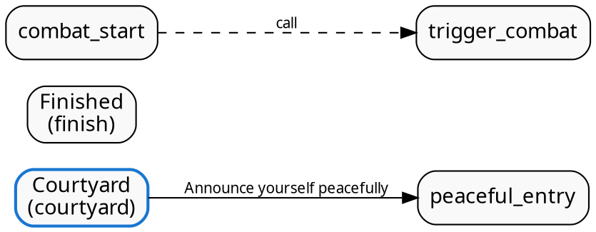
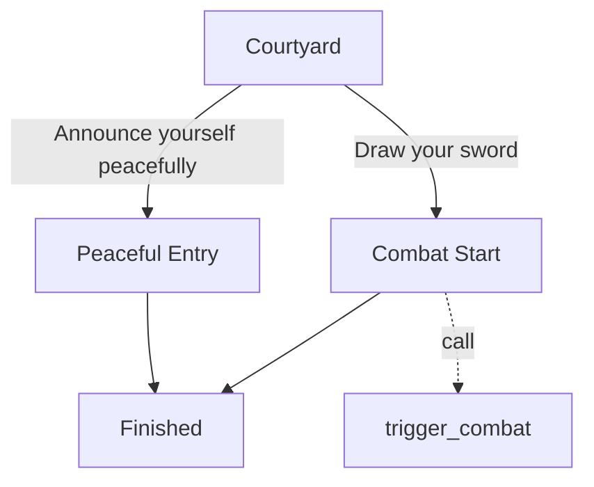

# Directed Scene Graph

While `eager_s.parse()` produces a flat list of AST items (ideal for step-by-step game execution), `eager_s.to_graph()` transforms that list into a **directed graph** representing the narrative topology.

---

## Conceptual Model

- **Nodes (`SceneNode`)**: Each `##` scene label block acts as a node. It encapsulates the scene's ID, display title, line number, speakers, hooks, and full AST body.
- **Edges (`SceneEdge`)**: Directed transitions between scenes created by:
  - `? Option (target)`: `kind="choice"`, with choice text stored in `.label`
  - `> target`: `kind="jump"`, `.label=None`
  - `>> target`: `kind="call"`, `.label=None`
- **Preamble**: Any top-of-script AST items appearing before the first scene label.

---

## Python API

### Creating a SceneGraph

```python
import eager_s

# Direct parse to graph
graph = eager_s.parse_graph(script_text)

# Or transform from existing AST items
items = eager_s.parse(script_text)
graph = eager_s.to_graph(items)
```

### Topological Queries

```python
# Entry scene
print(graph.entry)  # e.g. "courtyard"

# Adjacency
graph.successors("courtyard")  # ['peaceful_entry', 'combat_start']
graph.predecessors("finish")  # ['peaceful_entry', 'combat_start']

# Reachability
graph.reachable_from("courtyard")  # {'courtyard', 'peaceful_entry', 'combat_start', 'finish'}
graph.is_reachable("finish")  # True

# Structural analysis
graph.dead_ends()  # Scenes with no outgoing transitions
graph.terminal_scenes()  # Reachable scenes that conclude the story (no outgoing transitions and no return)
graph.branching_points()  # Scenes with > 1 outgoing transitions
graph.hubs(threshold=2)  # Scenes with in-degree (predecessors) >= threshold
```

### Scene Node Summaries

Each node in `graph.nodes` provides convenient metadata without needing to iterate the AST body manually:

```python
node = graph.nodes["courtyard"]

print(node.id)  # "courtyard"
print(node.display_name)  # "Courtyard"
print(node.speakers)  # ("Narrator", "Guard") - order-preserved unique speakers
print(node.hooks)  # ("play_sfx",) - order-preserved unique engine hooks
print(node.body)  # tuple of parsed AST items
```

---

## Exporting Formats

### 1. JSON Export

Full graph including AST item bodies:

```python
json_str = graph.to_json(indent=2)
```

Lightweight graph omitting AST bodies (ideal for structural overviews or node-based editor visualizers):

```python
# In Python
data = graph.to_dict(include_body=False)
json_str = graph.to_json(include_body=False, indent=2)
```

### 2. Graphviz DOT (`to_dot`)

Export to standard DOT syntax for visualization with Graphviz (`dot`, `xdot`, or web renderers):

```python
dot_source = graph.to_dot()
```

Sample output:


### 3. Mermaid Flowcharts (`to_mermaid`)

Export directly to Mermaid markdown diagrams for embedding in documentation, GitHub comments, or markdown previews:

```python
mermaid_source = graph.to_mermaid()
```

Sample output:


---

## CLI Usage

Generate graph exports directly from the command line:

```bash
# Export scene graph as JSON
eager-s graph script.es -o graph.json

# Export lightweight JSON without AST bodies
eager-s graph script.es --no-body -o structure.json

# Export Graphviz DOT file
eager-s graph script.es --format dot -o story.dot

# Render to Mermaid flowchart
eager-s graph script.es --format mermaid
```
